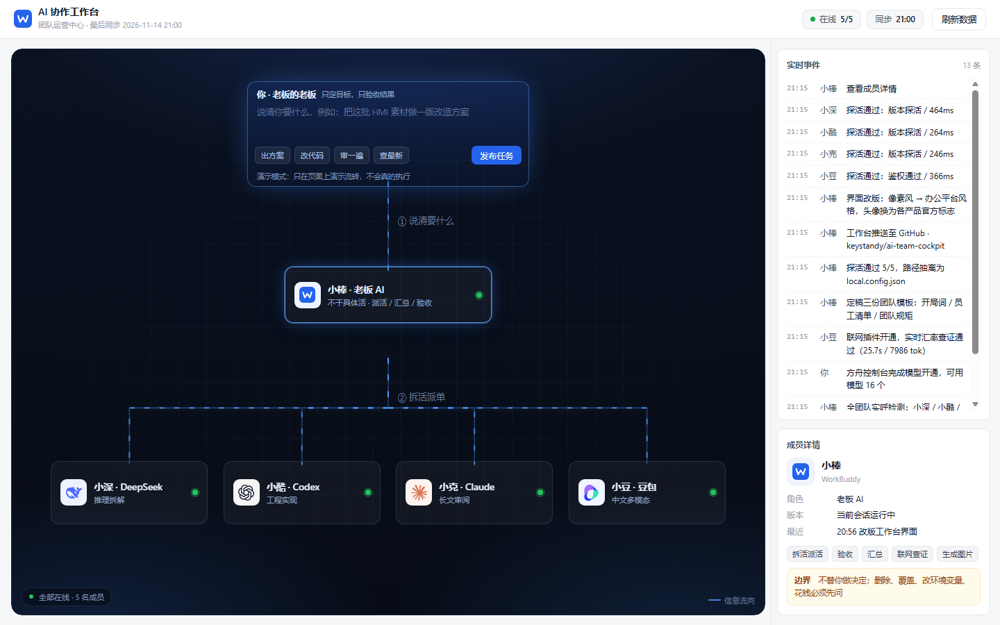

# AI 协作工作台

五个 AI 员工的组织结构，做成一张会动的流程图。发任务的入口就是最上面那个"你"的框。

- 打开：双击 `打开驾驶舱.cmd`，或直接开 `index.html`
- 刷新数据：`node probe.mjs`（免费，约 1 秒）／`node probe.mjs --live`（真发一句话，有微量费用）



---

## 主界面

```
        ┌──────────────────────────┐
        │ 你 · 老板的老板            │  ← 输入任务，点「发布任务」
        │ 只定目标，只验收结果        │
        └───────────┬──────────────┘
                    │ ① 说清要什么
        ┌───────────▼──────────────┐
        │ 小棒 · WorkBuddy          │  ← 拆解、判定、汇总
        │ 不干具体活 · 派活/汇总/验收 │
        └───────────┬──────────────┘
                    │ ② 拆活派单
        ┌───────┬───┴───┬───────┬───────┐
        ▼       ▼       ▼       ▼
      小深     小酷     小克     小豆
    DeepSeek  Codex   Claude    豆包
```

点「发布任务」后的动画顺序：

1. 一颗蓝色光点从「你」流向「小棒」，小棒节点亮起
2. 右栏记录「收到，正在拆解」
3. 光点分四路下发，命中的那一路更亮
4. 被指派的员工节点高亮，右栏记录「判定给谁（命中哪些关键词）」
5. 光点返回小棒（回报），再绿色返回给你（汇总）
6. 右栏出「本次派活单」，含任务、指派对象、可复制的命令

线条一直有流动的虚线动画，节点有呼吸灯和光晕。

## 派活判定怎么来的

按关键词计分，命中多的赢：

| 员工 | 触发词（举例） |
|---|---|
| 小酷 | 代码、脚本、重构、测试、bug、部署、实现、改 |
| 小克 | 审、挑错、检查、对比、复核、漏洞、校对 |
| 小豆 | 文案、看图、图片、翻译、新闻、最新、查一下、联网、润色、写 |
| 小深 | 方案、拆解、设计、分析、思路、结构、规划、推理 |

都没命中就默认给小深（拆解）。判定结果会写在事件流里，例如「判定给小深（命中：方案、结构）」。

## 重要：这个输入框目前是演示

静态页没法在浏览器里启动进程，所以：

| 它做了什么 | 它没做什么 |
|---|---|
| ✅ 播放完整的流转动画 | ❌ 不会真的调用员工 |
| ✅ 按关键词算出该给谁 | ❌ 不会真的执行命令 |
| ✅ 生成派活单和可复制的命令 | ❌ 不会回传真实结果 |

拿到命令后，复制到终端跑才是真执行。界面左下角标了「演示模式」。

想让它真的能派活，需要一个本地小服务（页面 POST 任务 → 服务端 spawn 对应 CLI → 回传日志）。这是下一步可以加的。

## 右侧栏

- **实时事件**：每次流转都会追加，最多保留 40 条
- **成员详情 / 本次派活单**：点节点看详情，发布任务后切成派活单

## 成员与标志

| 代号 | 引擎 | 标志 |
|---|---|---|
| 小棒 | WorkBuddy | 自绘 W 标记（该产品无公开标志） |
| 小深 | DeepSeek Harness | DeepSeek 官方彩色标志 |
| 小酷 | Codex CLI | OpenAI 官方标志 |
| 小克 | Claude Code | Claude 官方彩色标志 |
| 小豆 | 豆包 · 火山方舟 | 豆包官方彩色标志 |

图标取自 [@lobehub/icons-static-svg](https://github.com/lobehub/lobe-icons)（MIT），内联在 `assets/logos.js`，页面不请求任何外部资源。各标志的商标权归各自权利人，此处仅用于标识对应产品。

## 为什么没有直接装 munder-difflin

参考了 [munder-difflin](https://github.com/chaitanyagiri/munder-difflin) 的信息设计（每个 agent 一张卡、主管只把花钱和破坏性操作上报给人），但没有装它：

| 对比 | munder-difflin | 本工作台 |
|---|---|---|
| 技术栈 | Electron + React + Pixi.js + node-pty | 单页 HTML + 原生 JS，零依赖 |
| 安装 | `npm install` + 编译 node-pty（要 C/C++ 工具链） | 不用装，双击就开 |
| 磁盘占用 | 几百 MB（npm 缓存 + Electron） | 约 250 KB |
| 真实终端 | 每个 Agent 是真 PTY 进程 | 只做状态展示与流转演示 |

## 目录

```
.
├─ index.html                    工作台本体（单文件，含样式、流程图与动画）
├─ probe.mjs                     探活脚本，刷新 data/office.js
├─ data/office.js                数据快照（JS 而非 JSON，为了 file:// 能直接打开）
├─ assets/logos.js               五个产品标志（内联 SVG）
├─ local.config.example.json     本机路径配置模板
├─ preview.png                   效果截图
└─ 打开驾驶舱.cmd                 Windows 双击入口
```

## 刷新数据

```bash
node probe.mjs          # 只查版本/鉴权，不花钱，约 1 秒
node probe.mjs --live   # 真给每个员工发一句「只回复两个字：在线」
```

| 员工 | quick 模式 | live 模式 |
|---|---|---|
| 小深 | `bin.js --version` | headless 实呼，约 30s |
| 小酷 | `codex --version` | `codex exec`，约 12s |
| 小克 | `claude --version` | `claude -p`，秒级 |
| 小豆 | `GET /api/v3/models` 鉴权 | `chat/completions` 实呼，约 2s |

### 换台机器

复制 `local.config.example.json` 为 `local.config.json`，改里面的路径。该文件已被 `.gitignore` 忽略。某路径不对时，那个员工显示离线，不会崩。

## 改成员 / 加成员

编辑 `data/office.js`，字段：`id / name / role / engine / logo / version / status / ms / caps / last / latency / limit / cmd`。

`limit`（能力边界）那一项最值钱，别省。

加新成员时还要在 `index.html` 的 `POS.emp` 数组里补一个位置（逻辑坐标 960×640），并在 `ROUTE` 里给它加触发词。

## 调试用

在地址后面加 `#demo`，页面会自动填入一条示例任务并播放流转，方便截图和演示：

```
index.html#demo
```

## 占用

| 项 | 大小 |
|---|---|
| 全部文件 | 约 250 KB |
| npm 安装 | 无 |
| 外部资源请求 | 无 |
