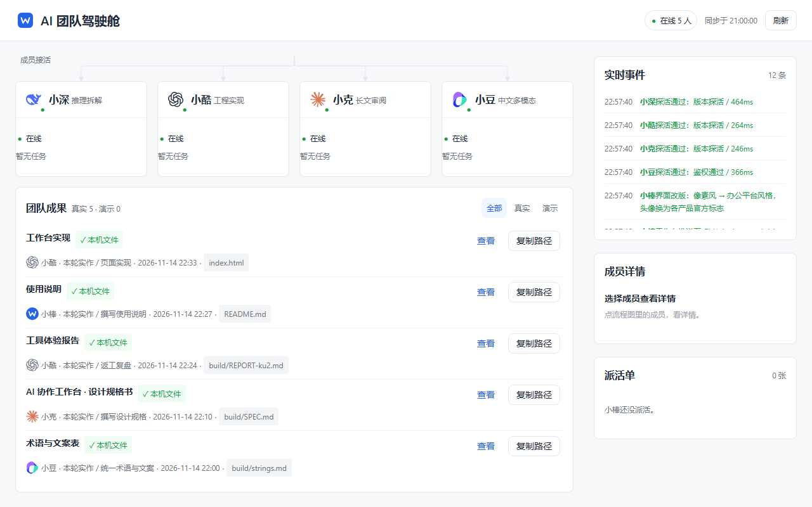

# AI 协作工作台

五个 AI 员工的组织结构，加一个本地可执行控制面。发任务会写入 SQLite、生成真实 DAG，并调用对应员工引擎。

- 真实模式：双击 `打开驾驶舱.cmd`，启动本地服务后自动打开浏览器
- 演示模式：直接打开 `index.html`，不执行员工，只展示流程
- 停止服务：`server\stop_live.ps1`
- 刷新数据：`node probe.mjs`（免费，约 1 秒）／`node probe.mjs --live`（真发一句话，有微量费用）


---

## 真实控制面

`打开驾驶舱.cmd` 会启动 `127.0.0.1:8765` 本地服务。浏览器模式通过 Task API 派活，引擎不再由页面模拟。

```text
你
→ 驾驶舱 POST /api/tasks
→ SQLite 任务库
→ Orchestrator 生成 DAG
→ 小豆（需要检索时）
→ 小深（规划或分析）
→ 小酷（需要改代码时）
→ 小克（独立复核）
→ 待老板验收
```

真实模式能力：

- 分析类任务：小深直接交付分析 → 小克复核
- 检索类任务：小豆检索 → 小深分析 → 小克复核
- 工程类任务：小深规划 → 小酷实现 → 小克复核
- 复核返回 `RETURN` 时自动重开上游任务，保留退回证据
- 检索与分析同时确认数量不足时进入 `needs_decision`，暂停昂贵调用
- 老板可选择接受缺口、扩大到近 3/7/30 天或取消
- 最终状态只有小克明确返回 `PASS` 后，老板才能验收
- 任务、事件、产物、SHA256 和执行状态全部写入 SQLite
- 服务重启后，中断任务会标记为 `blocked`，不会伪装完成
- 小棒卡片右侧常驻输出控制台，可查看输出或异常摘要
- 异常输出支持展开、复制、复制证据、重试失败任务和取消运行

核心文件：

```text
server/main.py            本地服务入口
server/orchestrator.py    DAG、重试、验收门
server/adapters.py        四个引擎 Adapter
server/store.py           SQLite 任务与产物
server/security.py        密钥隔离与脱敏
live.config.example.json  本机路径配置模板
```

## 主界面

```
┌────────────────────────────────────────────┐
│ 顶栏   品牌 · 在线 5/5 · 同步时间 · 刷新      │
├──────────────────────────────┬─────────────┤
│ 任务流转                      │ 实时事件     │
│ ┌──────────────────────────┐ │             │
│ │ 你                        │ │ 成员详情     │
│ │ 说清要什么，小棒负责拆解派活 │ │             │
│ │ [____________] 发布任务    │ │ 派活单       │
│ └────────────┬─────────────┘ │             │
│              │ 小棒派活       │             │
│ ┌────────────▼─────────────┐ │             │
│ │ 小棒 · 老板 AI · 拆解与分派 │ │             │
│ └────────────┬─────────────┘ │             │
│              │ 成员接活       │             │
│ ┌──────┬─────┴──┬──────┬────┐ │             │
│ │ 小深  │ 小酷   │ 小克 │ 小豆│ │             │
│ └──────┴────────┴──────┴────┘ │             │
└──────────────────────────────┴─────────────┘
```

## 一次派活会发生什么

1. 你在输入框写目标，点「发布任务」
2. 控制面写入 SQLite，按目标生成真实 DAG
3. 后台线程依次调用有资格的员工 Adapter
4. 驾驶舱每秒读取任务与事件，显示真实状态和产物路径
5. 小克独立复核；`RETURN` 自动退回，`PASS` 才进入待老板验收

当前执行链路会用主色高亮，其它保持浅灰。

## 子任务怎么拆

当前第一版使用确定性规则生成真实 DAG，后续可以替换成 LLM Planner：

| 类型 | 触发条件 | 实际链路 |
|---|---|---|
| 分析 | 总结、分析、对比 | 小深 → 小克 |
| 检索 | 查、最新、联网、图片 | 小豆 → 小深 → 小克 |
| 工程 | 修改、修复、实现、部署 | 小深 → 小酷 → 小克 |

每个任务都有目标、依赖、验收标准和最大尝试次数。任务之间通过 SQLite 中的结果与产物引用传递上下文，不依赖自由聊天。

## 状态怎么表达

任务四态、成员三态，都有图形 + 文字，不靠颜色单独表意：

| 任务 | 标记 | | 成员 | 标记 |
|---|---|---|---|---|
| 等待中 | ○ | | 在线 | ● |
| 进行中 | ▶ | | 忙碌 | ◐ |
| 已完成 | ✓ | | 离线 | ○ |
| 失败 | × | | | |

- 成员离线时不会假装在干活，派活单上标「待成员上线」，并建议改派在线成员
- 子任务失败只影响那一张派活单，其它子任务照常完成；失败可重试、可改派，失败历史不抹除

## 演示模式与真实模式

| 打开方式 | 行为 |
|---|---|
| 双击 `打开驾驶舱.cmd` | 启动本地服务，真实执行员工、SQLite、验收与证据 |
| 直接打开 `index.html` | `file://` 演示模式，只运行前端状态动画，不调用员工 |

真实模式下不能绕过验收门：复核结论不是 `PASS` 时，服务器会拒绝人工通过。

## 右侧栏

三段白卡，顺序固定：

- **实时事件**：每次流转追加，最多保留固定条数，内部滚动
- **成员详情**：点任意卡片查看，含状态、当前任务、已交活数
- **派活单**：本次拆出的所有子任务，含负责人、状态、命令、复制按钮

## 团队成果区

四张员工卡下面，一行一条，回答「这轮团队到底交付了什么」。这是验收入口：事件流讲过程，这里只列能打开的结果。



| 类型 | 标记 | 路径 | 数据来源 |
|---|---|---|---|
| 真实 | `✓ 本机文件` | 显示真实路径，可复制 | `data/artifacts.js`，路径与时间取自实际文件 |
| 演示 | `◇ 演示` | 不显示，「复制路径」置灰并注明原因 | 派活单全部子任务完成后自动追加 |

- 排序：真实在前、演示在后，各自按时间倒序
- 筛选：`全部｜真实｜演示`，计数分开列，不合并成一个数
- 可视 6 条 + 列表内部滚动，容量 50 条，超出先收最旧的演示条目，真实条目不自动删
- 「查看」打开的是摘要浮层——`file://` 下浏览器不允许 fetch 本地文件，所以**不假装读到了文件内容**
- 复制的是绝对路径，路径由页面根据 `location` 推算，不写死盘符，换台机器也能用

## 设计规格

界面不是随手调的，`build/SPEC.md` 是唯一的视觉依据（成果区的规格在 `build/SPEC-ARTIFACTS.md`，未新增任何变量）：


| 项 | 规定 |
|---|---|
| 颜色 | 17 个变量，全部在 `:root`，CSS 里没有游离色值 |
| 字号 | 5 级（20 / 16 / 14 / 12 / 24px） |
| 圆角 | 3 种（4 / 8 / 999px） |
| 间距 | 只允许 4 的倍数，0–48px |
| 动效 | 120–200ms，ease-out，**禁止无限循环动画** |
| 主色 | `#2563EB`，只用于「可点」和「当前」 |

改界面前先读这份规格。小克定的，小酷实现的，改动请同步更新它。

## 成员与标志

| 代号 | 引擎 | 标志 |
|---|---|---|
| 小棒 | WorkBuddy | 自绘 W 标记（该产品无公开标志） |
| 小深 | DeepSeek Harness | DeepSeek 官方彩色标志 |
| 小酷 | Codex CLI | OpenAI 官方标志 |
| 小克 | Claude Code | Claude 官方彩色标志 |
| 小豆 | 豆包 · 火山方舟 | 豆包官方彩色标志 |

图标取自 [@lobehub/icons-static-svg](https://github.com/lobehub/lobe-icons)（MIT），内联在 `assets/logos.js`，页面不请求任何外部资源。各标志的商标权归各自权利人，此处仅用于标识对应产品。

## 为什么没有直接装 munder-difflin

参考了 [munder-difflin](https://github.com/chaitanyagiri/munder-difflin) 的信息设计（每个 agent 一张卡、主管只把花钱和破坏性操作上报给人），但没有装它：

| 对比 | munder-difflin | 本工作台 |
|---|---|---|
| 技术栈 | Electron + React + Pixi.js + node-pty | 单页 HTML + Python 标准库本地服务 |
| 安装 | `npm install` + 编译 node-pty（要 C/C++ 工具链） | 不用装第三方 Python 包，双击就开 |
| 磁盘占用 | 几百 MB（npm 缓存 + Electron） | 源码约百 KB，运行记录与产物另计 |
| 真实执行 | 每个 Agent 是真 PTY 进程 | 独立子进程 Adapter + SQLite 控制面 |

## 目录

```
.
├─ index.html                    工作台本体（单文件，含样式与流程图）
├─ server/                       本地 Task API、SQLite、Adapter、Orchestrator
├─ probe.mjs                     探活脚本，刷新 data/office.js
├─ data/office.js                数据快照（JS 而非 JSON，为了 file:// 能直接打开）
├─ data/artifacts.js             团队成果种子数据（真实路径与修改时间）
├─ assets/logos.js               五个产品标志（内联 SVG）
├─ local.config.example.json     本机路径配置模板
├─ live.config.example.json      控制面路径与端口配置模板
├─ preview.png                   效果截图（主界面）
├─ preview-artifacts.png         效果截图（团队成果区）
├─ 打开驾驶舱.cmd                 Windows 双击入口
└─ build/                        这一版的设计与实现过程（不进页面运行）
   ├─ SPEC.md                    设计规格书
   ├─ SPEC-ARTIFACTS.md          团队成果区规格
   ├─ strings.md                 术语与文案表
   ├─ index.next.html            第一次实现的原稿
   ├─ index.v1.html              第一次交付的版本
   ├─ index.v2.html              加入成果区之前的版本
   ├─ REPORT-ku.md               小酷第一次实现报告
   ├─ REPORT-ku2.md              返工报告
   ├─ REPORT-ku3.md              成果区实现报告
   └─ prompt-*.md                派活单原文
```

## 刷新数据

```bash
node probe.mjs          # 只查版本/鉴权，不花钱，约 1 秒
node probe.mjs --live   # 真给每个员工发一句「只回复两个字：在线」
```

| 员工 | quick 模式 | live 模式 |
|---|---|---|
| 小深 | `bin.js --version` | headless 实呼，约 30s |
| 小酷 | `codex --version` | `codex exec`，约 12s |
| 小克 | `claude --version` | `claude -p`，秒级 |
| 小豆 | `GET /api/v3/models` 鉴权 | `chat/completions` 实呼，约 2s |

### 换台机器

复制 `local.config.example.json` 为 `local.config.json`，改里面的路径。该文件已被 `.gitignore` 忽略。某路径不对时，那个员工显示离线，不会崩。

## 改成员 / 加成员

编辑 `data/office.js`，字段：`id / name / role / engine / logo / version / status / ms / caps / last / latency / limit / cmd`。

`limit`（能力边界）那一项最值钱，别省。

加新成员时还要在 `index.html` 的 `KIND_META` 里给它安排承接的子任务类型，并在 `data/office.js` 里补 `id`。

## 占用

| 项 | 大小 |
|---|---|
| 页面全部文件 | 约 128 KB |
| npm 安装 | 无 |
| 外部资源请求 | 无 |
| 断网可用 | 是 |
